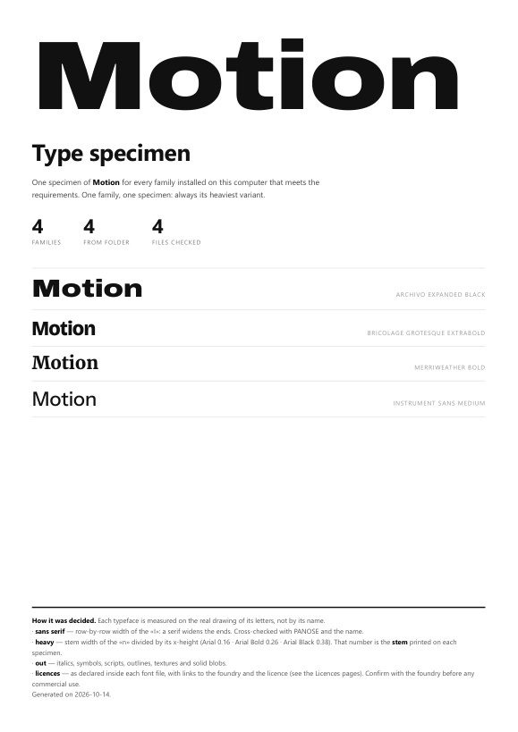
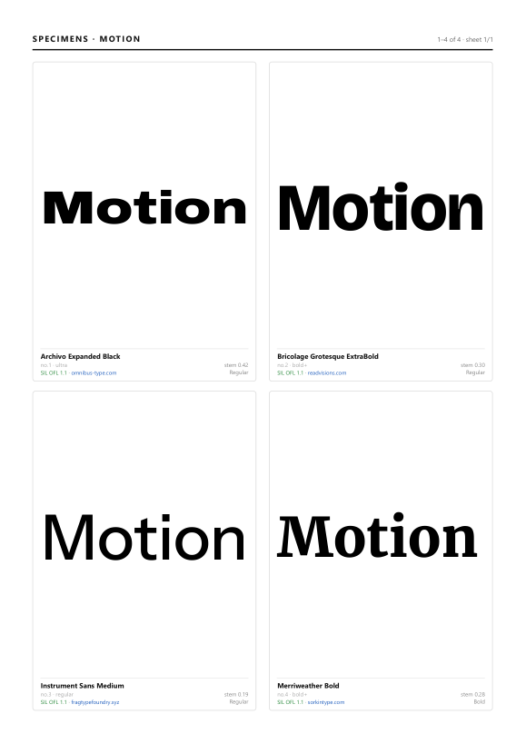

# type-specimen-finder

**Write one word in every typeface on your computer that meets a brief — and get a print-ready PDF specimen book, with each font's licence and a link to its foundry.** Typefaces are chosen by measuring the real drawing of their letters, not by trusting their names.

| Cover | Specimen sheet | Licences |
|---|---|---|
|  |  |  |

*(Demo built from the four OFL fonts in `tests/fonts`. On a real machine the book lists hundreds of families.)*

## Why

Picking a typeface for a logo or a title often starts with "show me every heavy sans serif I have". Font names are unreliable for that: Impact calls itself *Regular*, some *Ultra* weights are lighter than another family's *Bold*, and decorative faces hide behind plain names. This tool scans the fonts, **measures** them and lays the word out on a clean A4 book, one specimen per family.

## Quickstart

```bash
pip install -r requirements.txt
python specimen.py "Hello"                      # every heavy sans serif on this computer
python specimen.py "Hello" --min-stem 0.33      # only black weights
python specimen.py --search "grotesk"           # what is installed, with its measures
python specimen.py "Hello" --selection picks.txt --per-page 6   # a shortlist, no filters
```

Output (in `out/`): `Hello_specimen.pdf` (cover, alphabetical list, list by weight, licences, specimen sheets), `Hello_list.txt`, `Hello_licences.csv` (for a spreadsheet) and `Hello_illustrator.json` (for Illustrator, below). It needs Chrome, Chromium or Edge to print the PDF (headless), and works on Windows, macOS and Linux.

On Windows, double-click `specimen.bat`: it installs the requirements the first time, asks for the word and the minimum stem, and opens the PDF.

## In Illustrator

`illustrator/TypeSpecimen.jsx` turns the same selection into a working document: a new Illustrator file with one artboard per typeface, the word set as live, editable text in that face and a caption with its name, licence and measured stem. Retype the word, change the size or copy an artboard into a layout; nothing is outlined.

1. Run `specimen.py` (or `specimen.bat`) as above; it writes `out/<word>_illustrator.json`.
2. In Illustrator: *File > Scripts > Other Script...*, pick `TypeSpecimen.jsx`, then pick the JSON.
   To have it in the *Scripts* menu, copy it to Illustrator's `Presets/<language>/Scripts` folder and restart.

Faces are matched by PostScript name, then by family and style; any face Illustrator cannot find (not activated, or named differently) is listed at the end instead of being set in a fallback font. The script only creates new documents, never touches the ones already open, and splits a long list over several documents (about 470 artboards each, the size of the canvas). Tested with Illustrator 2026: 777 typefaces in 25 seconds.

## Licences and foundries

Every specimen shows the font's licence and a clickable link to its foundry, and a Licences section lists them all with the embedding permission and a link to the licence text. All of it is read from the font file itself: the OpenType `name` table (8 manufacturer, 11 vendor URL, 12 designer URL, 13 licence description, 14 licence URL) and `OS/2 fsType`.

| Shown as | When the file says |
|---|---|
| **SIL OFL 1.1**, **Apache 2.0**, **Ubuntu Font Licence**, **Creative Commons**… | an open licence |
| **Personal use only** (in red) | "free for personal use", "non-commercial"… This is the one to catch before client work |
| **Bundled with Windows / macOS / another product** | a font licensed with an operating system or an application |
| **Commercial / proprietary** | EULA, licence agreement, all rights reserved… |
| **Not declared in the file** | nothing at all, which is common: on a real designer's machine about 2 in 3 families declare no licence |

**Embedding** reads `fsType` as the OpenType spec says: *installable*, *editable*, *preview & print* or *restricted*. When several bits are set, the least restrictive one applies. A *restricted* font can't legally be embedded in a PDF you send out.

Font files are often incomplete or out of date, so the report says what each file **declares**, never more. Always confirm the terms with the foundry before commercial use, web embedding or redistribution.

## How it decides

Each face is rendered with Pillow and measured:

| Measure | What it is | Reference values |
|---|---|---|
| **stem** | width of the left stem of the `n` ÷ its x-height | Arial 0.16 · Arial Bold 0.26 · Impact 0.30 · Arial Black 0.38 · Gotham Ultra 0.41 |
| **serif** | widest row ÷ median row width of the `I` | sans serif 1.00 · Rockwell 2.40 · Times 3.09 |

- **Sans serif**: rejected if `serif > 1.42`, cross-checked with the font's PANOSE data and with name hints (*slab*, *antiqua*, *clarendon*…).
- **Heavy**: kept if `stem ≥ 0.25` (heavier than Arial Bold) even when the name says *Regular*. A face that declares itself Bold or Black is also kept if it has some body (`stem ≥ 0.14`), which rescues condensed faces such as Bebas Neue Bold.
- **Out**: italics, symbols, scripts, outlines, textures, blackletter and solid blobs (`stem > 0.60` is no longer a letter). A second pass draws the whole word and counts ink runs per row: distressed or hatched faces give themselves away.
- **One family, one specimen**: weight words are stripped from the name (`Montserrat Black` → `montserrat`) and the heaviest variant wins. Widths stay separate: `Gotham` and `Gotham Narrow` are two families.

The word is then fitted to fill each box (it grows or shrinks after `document.fonts.ready`), the HTML is printed to PDF by a headless browser, and the PDF is re-opened with PyMuPDF to check that no specimen fell back to the default font.

## Options

| Option | |
|---|---|
| `--selection list.txt` | PDF with only those typefaces, no filters (fuzzy names: `Swis721 BlkRnd BT Black` works) |
| `--search text` | faces matching a text, with their measures |
| `--per-page 6` | specimens per sheet (12 by default) |
| `--min-stem 0.3` | heavier only (0.25 ≈ Arial Bold, 0.33 ≈ Black) |
| `--with-serif` / `--all-weights` / `--italics` / `--oddities` | relax the filters |
| `--fonts-dir DIR` | scan a folder instead of the system fonts (repeatable) |
| `--list-only`, `--rescan`, `--title`, `--name`, `--out` | |

The system scan takes about a minute for ~8,000 font files and is cached in `cache/fonts.json`. The next run starts in a second, as long as the new word only uses letters already checked.

## Lessons learnt

- Ink density (ink ÷ box) does **not** measure weight: a light condensed face scores higher than Arial Bold. The stem width does.
- To make a word *grow* to fill a box, measure an inner `<span>`: `scrollWidth` never drops below the container width, so it can only shrink.
- Headless Chrome loads `@font-face` from `file:///` only with `--allow-file-access-from-files`, and `.ttc` collections can't be addressed by index from CSS, so those use `local()`.
- Counting distinct fonts in the PDF doesn't work (Chrome embeds many subsets with empty names); the check is done by the position of each specimen.
- Licence data in font files is patchy: on one real machine, 543 of 787 heavy sans families declared no licence and 21 were "personal use only". A restriction ("non-commercial") must be checked before any open-licence keyword, or a vague mention of OFL would hide it.

## Tests

```bash
python -m pytest tests
```

The tests use four fonts under the SIL Open Font License, bundled in `tests/fonts` (licence and copyrights in `tests/fonts/OFL.txt`): two heavy sans serifs that must be kept, a medium sans serif that must be dropped as too light, and a heavy serif that must be dropped for its serifs. They also check the licence classification (including personal-use and bundled fonts), the embedding permissions and that only http(s) links are produced. The PDF test, which runs when a browser is available, checks that the licence links are clickable.

## Built with AI-assisted workflows

Designed and directed by a motion and creative technologist, with code written in pair with an AI coding agent. The measuring rules come from real use: choosing a title typeface among ~800 families.

Licence: GPL-3.0-or-later (see `LICENSE`) · fonts in `tests/fonts` under OFL 1.1
